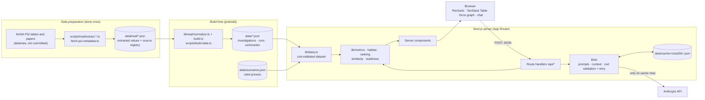

# FireSight

**What real NASA fire tests cover, and what they miss, for crewed habitats.**
NASA Space Apps Challenge 2026 · *Flame in Freefall*

FireSight is a web dashboard over the combustion data NASA has archived in Physical Science Informatics (PSI), plus published results from the Saffire IV–VI flights. Its centerpiece is the **Habitat Flammability Explorer**. You enter a proposed cabin atmosphere (oxygen % and total pressure), and it shows:

- a coverage verdict for solid, liquid and gaseous fuels: tested, near tested runs, not tested, or no run data
- the nearest real experiments, with their recorded outcomes and where each value comes from
- what the data we hold never tested at that atmosphere

> **Real data only.** 772 run-level tests: 764 from PSI tables (BASS, BASS-II, FLEX, CFI, Saffire I–III) and 8 hand-transcribed from NASA papers (Saffire IV–VI, marked "published paper"). Every run records its file and its exact place in it. Missing values stay missing. Nothing is generated, and FireSight makes no predictions.

It supports engineering judgment. It does not replace NASA flammability standards such as NASA-STD-6001.

**Headline finding.** In the PSI data we examined, solid materials were tested only at about cabin conditions (about 14–23% O2, about 14.7 psi). Liquid droplets reached exploration-like atmospheres (FLEX: 30–34% O2 at about 10.3 psi; CFI down to 7.35 psi). The later Saffire flights, which are not in PSI, burned solids at 25.4–26.2% O2 and about 10.3 psi (Saffire-V) and 28.8–31% O2 and about 7.9 psi (Saffire-VI). No solid-material run in this data reaches the 34% O2, 8.2 psi lunar exploration atmosphere.

---

## Features

| Page | What it does |
| --- | --- |
| `/habitat` | **Main feature.** Presets and sliders for O2 (15–100%) and pressure (3–15 psi), plus material, airflow and gravity. Shows pO2 and O2 vs Earth, a coverage verdict per fuel category, a map of real runs coloured by recorded outcome (hollow markers mean pressure not recorded), the nearest real runs, a "never tested" list, a structured SI interpretation and an explainable ranking with weight sliders. |
| `/explore` | TanStack table of 20 investigations with fuse.js search and filters (fuel category, data held, hardware, pillar, O2 range of real runs). The detail sheet shows the PSI record verbatim, every real run with its source reference and caveats, known data issues and the citation (DOI, licence). Compare mode (2–4 records) overlays real runs and adds an SI comparison. |
| `/graph` | Similarity network over PSI-listed relations, hardware, project, material classes and category. Each insight states its source. |
| `/ask` | Streaming Q&A grounded in six retrieved records, their run statistics and example runs, with citations to investigation and run ids. |
| `/scenarios` | Mission readiness per habitat preset: coverage verdict per fuel category, nearest real solid-material runs, the team's pillar evidence lists, gaps, and where the preset's atmosphere values come from. |
| `/earth` | Earth benefits quoted from each PSI record, grouped by keyword. |
| `/about` | Data policy, sources table with DOIs and licences, coverage, ranking and similarity methods, SI layer, open items. |

Deep links for demos:
- `/habitat?preset=lunar-base`
- `/habitat?preset=mars-transit`
- `/explore?id=saffire-iv-vi`
- `/graph?insight=daft-same`

---

## Quick start

Prerequisites: Node.js 20.9 or newer (22 recommended), npm.

```bash
npm install
cp .env.example .env.local      # then add ANTHROPIC_API_KEY (optional; see below)
npm run dev                     # http://localhost:3000
```

The built dataset and any precomputed SI outputs are committed, so the app runs straight after `npm install`. Without an API key, every non-SI feature works; SI panels show "SI unavailable" except for outputs already in `data/cache`.

### Environment variables (`.env.local`)

| Variable | Default | Purpose |
| --- | --- | --- |
| `ANTHROPIC_API_KEY` | (none) | Used only by server-side route handlers; never sent to the browser. |
| `MODEL_MAIN` | `claude-sonnet-5-5` | Summaries, comparisons, habitat interpretation, readiness notes, Q&A. |
| `MODEL_FAST` | `claude-haiku-5-5` | Graph edge explanations. |
| `USE_CACHE_ONLY` | `false` | When `true`, never call the API; serve cached outputs only (demo safety). |

### Scripts

| Command | What it does |
| --- | --- |
| `npm run dev` / `npm run build` / `npm start` | Next.js dev server, production build (runs `prebuild`), production server. |
| `npm run build:data` | Normalizes `data/real/*.json` into `data/investigations.json`, `runs.json` and `summaries.json`, checks unit conversions and cross-file facts, and fails without writing on any error. Runs before every build (`prebuild`). |
| `npm run fetch:psi` | Refreshes `data/real/psi-investigations.json` from the PSI search service. |
| `npm run prewarm` | Generates and caches SI outputs for the demo (needs an API key). `-- --core` limits it to summaries, scenario notes and preset interpretations. |
| `npm test` | Vitest: provenance, no invented outcomes, unit conversions, normalizers on real fixtures, coverage, ranking, similarity, readiness on the real data, retrieval, and the SI pipeline with a mocked client. |
| `npm run lint` / `npm run typecheck` | ESLint and `tsc --noEmit`. |

On Windows, `npm test` goes through `scripts/run-vitest.mjs`, which upper-cases the drive letter because vitest fails with `c:\...`.

---

## Architecture



- **No database.** Data lives in versioned JSON, is imported statically and validated once with zod.
- **One assessment function.** `assessHabitat` in `lib/habitat.ts` feeds the page, the SI route and the prewarm script, so the SI sees exactly what the user sees.
- **Server-side SI.** Structured calls ask for JSON only, validate it with zod and retry once. Habitat evidence may only cite ids sent in the ranked list. Prompts require citing investigation and run ids, stating missing fields and outcome bases, and forbid predictions.
- **Caching.** Results are cached by a sha256 of kind, model, prompt version and grounded input, so data or prompt changes invalidate them.

### Project structure

```
app/            routes and app/api/* route handlers
components/     ui/ (shadcn) plus habitat, explore, graph, ask, scenarios, si, charts, shell, common
lib/            schema, data, validate, metrics, habitat, ranking, similarity, readiness, graph, earth, search, ai/
lib/real/       normalize.ts (per-dataset mappers), build.ts (investigation config and assembly)
data/real/      extracted NASA values, PSI metadata, citations, source registry
data/           built investigations.json, runs.json, summaries.json; scenarios.json; cache/
scripts/        build-data, prewarm-cache, real/ (extractors and PSI metadata fetch)
tests/          vitest suites
```

---

## Data

`lib/schema.ts` is the contract.

- **Runs** (`runs.json`): one record per real test. Nearly every value is nullable. Each run carries `dataSource` (`psi` or `published`), `sourceKind` (`psi-table` or `paper`) and `source: { file, ref }` (sheet and row, or paper, table and page). Outcomes carry a basis: `source-field` (a table column), `notes-keyword` (read from investigator notes and reviewed by a person) or `none` (the outcome is "not stated").
- **Pressure policy.** `pressureStatus` is `measured`, `paper` or `not-recorded`. For BASS-II, which records no pressure, a cited ISS nominal (14.7 psi, NASA ECLSS technical brief) is kept in a separate `pressureAssumedPsi` field and drawn as a hollow marker; it is never stored as a measured value.
- **Summaries** (`summaries.json`): FLEX-2 planned matrix, ACME BRE day-level summary, SPICE burner log and SLICE schedule. They are never plotted or counted as runs.
- **Investigations** (`investigations.json`): built from PSI metadata (title, platform, dates, objectives, approach, hypothesis, earth benefits, hardware, publications, related investigations), DataCite citations and licences, and known issues from the source registry. O2, pressure and flow ranges come from run-level data only. Fuel category and safety pillars are the team's classification, stored with their basis and shown as "team assessment".
- **Scenarios** (`scenarios.json`): each preset cites its atmosphere source or is marked "citation needed". The lunar preset (34% O2 at 8.2 psi) cites the Saffire status paper, NTRS 20170000230, page 7.

Build-time checks (`lib/validate.ts`): provenance on every run, outcome only with a basis, no measured pressure where none was recorded, psi vs kPa agreement, ranges equal to the runs' min and max, and source conversions (atm × 14.6959, mmHg × 0.0193368, kPa × 0.145038).

Sources and reuse terms are listed in `data/real/source-registry.json` and on the About page. 16 of the 19 PSI investigations list CC0 1.0 in DataCite; PSI-10, PSI-20 and PSI-22 list no licence.

---

## Deploying to Vercel

1. Import the repo in Vercel. `vercel.json` pins `npm ci` and `npm run build`; `prebuild` rebuilds and validates the dataset from `data/real`.
2. Add `ANTHROPIC_API_KEY`, `MODEL_MAIN`, `MODEL_FAST`, and for a public demo `USE_CACHE_ONLY=true`.
3. Commit `data/cache/*.json` after `npm run prewarm`. `next.config.ts` traces those files into the API functions.

---

## 3-minute demo script

Before presenting: run `npm run prewarm` with an API key, commit `data/cache`, set `USE_CACHE_ONLY=true`, open `/habitat`.

1. **(0:00) Frame it.** "Exploration habitats run at lower pressure and higher oxygen than the ISS. We read the combustion data NASA archived in PSI. What has actually been tested?" Point at the *Real NASA PSI data* banner.
2. **(0:20) ISS cabin.** The default preset: solids and liquids both *Tested*, with hundreds of real runs on the map.
3. **(0:40) Lunar exploration atmosphere.** Pick the lunar preset (34% O2, 8.2 psi).
   - Solids: *Near tested runs*. The nearest is a Saffire-VI sample at 31% O2, 7.85 psi, from a published paper.
   - Liquids: *Not tested*; the nearest FLEX run is at 34% O2 but 10.3 psi.
   - Gases: *No run data*.
   - Read the "never tested" list: no solid run at 34% O2 or higher.
4. **(1:20) Mars transit.** Switch to Mars transit (26.5%, 10.2 psi): solids are *Tested*, but only by three Saffire-V samples. Point out that every run is microgravity.
5. **(1:40) SI interpretation.** Run it: the summary leads with the verdict, cites run ids and names missing fields.
6. **(2:10) Trace a number.** Click a nearest run's investigation. The Explorer shows the run with its source sheet and row, and the PSI citation.
7. **(2:40) Close.** "In the PSI data we examined, solids were tested at cabin conditions. Exploration atmospheres were reached by liquid droplets and by the newer Saffire flights. FireSight shows where the next solid-material experiment should go."

Never say "nothing has been tested": say "in the data we examined".

---

## Limitations

- **Coverage, not prediction.** The verdicts compare atmospheres only. FireSight does not estimate ignition probability or flame spread.
- **Gravity.** Every run is microgravity; lunar and Mars gravity are not represented.
- **Outcomes.** Some outcomes are keyword reads of investigator notes (labelled); many are not stated in the source.
- **Saffire IV–VI.** Hand-transcribed from papers; a second-person check against the PDFs is still open.
- **SI output.** Constrained to the provided records but can still be wrong. Check the cited ids.

Built with Next.js 16 (App Router), TypeScript, Tailwind CSS, shadcn/ui, Recharts, TanStack Table, react-force-graph-2d, zod, fuse.js and the Anthropic TypeScript SDK.
