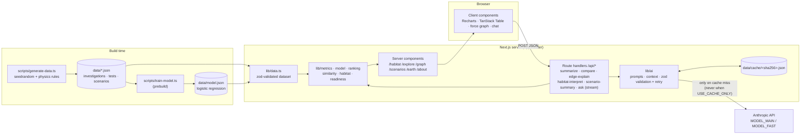

# FireSight

**Fire safety insight for crewed habitats, from microgravity combustion research.**
NASA Space Apps Challenge 2026 · *Flame in Freefall*

FireSight is a web dashboard that summarizes, ranks and interprets NASA Physical Science Informatics (PSI) combustion investigations for crewed habitats: ISS, Orion, a lunar surface base, pressurized rovers and Mars transit. Its centerpiece is the **Habitat Flammability Explorer**. You enter a proposed cabin atmosphere (oxygen % and total pressure), and it shows:

- where that point sits among tested microgravity combustion conditions
- which investigations cover it, and what is untested
- a predicted ignition likelihood from a small model trained on test-level runs

> **Synthetic demo data.** Investigation names, hardware and project groupings are real. Every number, test run, finding and measurement in this build is generated from a fixed seed. The app shows a persistent banner, and every record carries `dataSource: "synthetic"`. Do not cite any value here as a NASA result.

It supports engineering judgment. It does not replace NASA flammability standards such as NASA-STD-6001.

---

## Features

| Page | What it does |
| --- | --- |
| `/habitat` | **Main feature.** Presets and sliders for O2 (15–100%) and pressure (3–15 psi), plus material, airflow and gravity. Shows: a scatter of all same-phase test runs with constant-pO2 curves, preset markers, the shaded coverage gap and your cabin point; readouts (pO2, O2 vs Earth, ignition gauge, KNN flame spread, covering records, gap flag); an O2 sensitivity sweep; an explainable ranking with weight sliders; a partial-gravity callout; a structured SI interpretation. |
| `/explore` | TanStack table of 19 investigations with fuse.js search and filters (fuel phase, hardware, pillar, habitat relevance, O2 range). The detail sheet has the SI summary, variables vs constants and a test scatter. Compare mode (2–4 records) adds a relevance radar, overlaid scatters and an SI comparison. |
| `/graph` | Force-directed similarity network: weighted Jaccard over hardware, fuels, phase, instruments, diluents and pillars. Threshold slider; click a link for a two-sentence SI explanation; insight callouts (SAME to DAFT instrument reuse, the SPICE flow duct family). |
| `/ask` | Streaming Q&A grounded in the six retrieved records plus their aggregate test stats, with citations that link to the Explorer. |
| `/scenarios` | Mission readiness scorecard per habitat preset: prevention, detection and suppression coverage, fabric ignition probability, best records, biggest gaps and an SI readiness note. |
| `/earth` | Earth applications grouped into suppression, smoke detection, firefighter gear, flammability standards and cleaner combustion. |
| `/about` | Data policy, generation rules, model card (features, coefficients, train and holdout accuracy), ranking and similarity methods, SI layer. |

Deep links that help in demos:
- `/habitat?preset=lunar-base`
- `/explore?id=bass-ii`
- `/explore?compare=bass,bass-ii,saffire-ii`
- `/graph?insight=same-daft`

---

## Quick start

Prerequisites: Node.js 20.9 or newer (22 recommended), npm. No GPU, no database; it runs comfortably on an 8 GB laptop.

```bash
npm install
cp .env.example .env.local      # then add ANTHROPIC_API_KEY (optional; see below)
npm run dev                     # http://localhost:3000
```

The synthetic data, trained model and any precomputed SI outputs are committed, so the app runs straight after `npm install`.

Without an API key, every non-SI feature works. SI panels show a friendly "SI unavailable" message, except for outputs already in `data/cache`.

### Environment variables (`.env.local`)

| Variable | Default | Purpose |
| --- | --- | --- |
| `ANTHROPIC_API_KEY` | (none) | Used only by server-side route handlers; never sent to the browser. |
| `MODEL_MAIN` | `claude-sonnet-5-5` | Summaries, comparisons, habitat interpretation, readiness notes, Q&A. |
| `MODEL_FAST` | `claude-haiku-5-5` | Graph edge explanations. |
| `USE_CACHE_ONLY` | `false` | When `true`, never call the API; serve cached outputs only (demo safety). |
| `DATA_SEED` | `42` | Seed for `npm run generate`. |

### Scripts

| Command | What it does |
| --- | --- |
| `npm run dev` / `npm run build` / `npm start` | Next.js dev server, production build (runs `prebuild`), production server. |
| `npm run generate` | Regenerates `data/investigations.json`, `tests.json` and `scenarios.json` from `DATA_SEED`, validates them, and retrains `data/model.json`. |
| `npm run train` | Validates the data and retrains the ignition model. Runs automatically before every build (`prebuild`). |
| `npm run validate:data` | Schema and cross-file checks (ids, ranges vs tests, units). |
| `npm run prewarm` | Generates and caches SI outputs for the demo (needs an API key). `-- --core` limits it to summaries, scenario notes and preset interpretations. |
| `npm test` | Vitest suite: generator, metrics, model, similarity, ranking, readiness, retrieval and the SI pipeline with a mocked client. |
| `npm run lint` / `npm run typecheck` | ESLint and `tsc --noEmit`. |

On Windows, `npm test` goes through `scripts/run-vitest.mjs`. The wrapper upper-cases the drive letter, because vitest fails when the shell's working directory is `c:\...` instead of `C:\...`.

---

## Architecture



How the pieces fit:
- **No database.** Data lives in versioned JSON in `/data`, is imported statically, and is validated once with zod.
- **Shared math.** All habitat numbers come from one pure function, `assessHabitat` in `lib/habitat.ts`. The page, the SI route and the prewarm script all use it, so the SI always sees exactly what the user sees.
- **Server-side SI.** All model calls happen in route handlers, with input size limits and friendly error JSON.
  - Structured calls ask for JSON only, validate it with zod and retry once with the validation error appended.
  - Habitat evidence may only cite investigation ids that were sent in the ranked list.
  - `MODEL_MAIN` calls opt into server-side refusal fallbacks.
- **Caching.** Results are cached by a sha256 of kind, model, prompt version and grounded input, so a data change automatically invalidates them. On read-only hosts, new entries go to the OS temp directory.

### Project structure

```
app/            routes (pages) and app/api/* route handlers
components/     ui/ (shadcn) plus feature folders: habitat, explore, graph, ask, scenarios, si, charts, shell, common
lib/            schema, data, metrics, model, ranking, similarity, habitat, readiness, graph, earth, search, ai/
data/           investigations.json, tests.json, scenarios.json, model.json, cache/
scripts/        generate-data, train-model, validate-data, prewarm-cache, generator/ (designs, physics, findings)
tests/          vitest suites
```

---

## Data model and synthetic generation

`lib/schema.ts` defines three files:
- **`investigations.json`**: one record per investigation. Fields include project, platform, hardware, fuel phase, fuels, tested O2, pressure (psi and kPa) and flow ranges, diluents, gravity level, objectives, variables vs constants, measurements, key findings, safety pillars, habitat relevance 0–5 with rationale, Earth applications, source URLs and `dataSource`.
- **`tests.json`**: one row per test run (20–60 per investigation, 876 in total). Fields include conditions, fuel and sample size, ignition and outcome, spread rate, burn duration, peak temperature, smoke obscuration and droplet extinction diameter.
- **`scenarios.json`**: habitat presets: Earth sea level, ISS cabin, spacesuit, lunar base (34% at 8.2 psi), pressurized rover (30% at 10.2 psi) and Mars transit (26.5% at 10.2 psi).

The generator (`scripts/generator/`) gives each investigation its own seeded stream and applies simple, monotone physics:
- Ignition is logistic in O2 partial pressure, with phase-specific midpoints.
- Spread is linear in O2 above a threshold, with mild pressure scaling.
- In microgravity, airflow drives the outcome for solids: starvation below about 5 cm/s, blowoff above about 30 cm/s.
- CO2 suppresses more strongly than helium.
- Droplet extinction diameters shrink as O2 rises, and cool flames appear at lower O2.

Investigation ranges are computed from the tests, and findings are templated from test statistics, so the two files always agree. A deliberate gap (no solid-fuel runs at 30–40% O2 below 10.5 psi) makes the lunar base and rover presets reveal untested territory.

### Swapping in real PSI data

1. Export PSI investigations and test runs into the shapes in `lib/schema.ts`, with `dataSource: "psi"`. Keep investigation `id`s as lowercase slugs. Put measurement and hardware names in canonical form (shared names drive the similarity graph).
2. Replace `data/investigations.json`, `data/tests.json` and, if needed, `data/scenarios.json`. Compute each investigation's O2, pressure and flow ranges from its runs: `lib/ranges.ts` does this, and the validator enforces it.
3. Run `npm run validate:data`, then `npm run train` (or just `npm run build`, which retrains in `prebuild`).
4. Delete stale `data/cache/*.json` and run `npm run prewarm`. Cache keys include the grounded input, so stale entries are simply never hit.

No app code changes are needed. The synthetic-only pieces switch themselves off when data is not synthetic:
- the shaded gap on the habitat chart
- the "committed files match the generator" test

---

## Deploying to Vercel (free tier)

1. Push the repo to GitHub and import it in Vercel. `vercel.json` pins `npm ci` and `npm run build`; dev dependencies install by default, so `prebuild` can retrain the model.
2. Add environment variables: `ANTHROPIC_API_KEY`, `MODEL_MAIN`, `MODEL_FAST`, and for a public demo `USE_CACHE_ONLY=true`.
3. Commit `data/cache/*.json` after `npm run prewarm`. `next.config.ts` traces those files into the API functions (`outputFileTracingIncludes`).

API routes set `maxDuration = 60`. With `USE_CACHE_ONLY=true` the deployed demo never calls the API and costs nothing.

---

## 3-minute demo script

Before presenting:
1. Run `npm run prewarm` with an API key and commit `data/cache`.
2. Set `USE_CACHE_ONLY=true` so nothing depends on the network.
3. Open `/habitat`.

1. **(0:00) Frame it.** "Exploration habitats run at lower pressure and higher oxygen than the ISS. Is that more flammable, and what has actually been tested?" Point at the *Synthetic demo data* banner.
2. **(0:20) Lunar base preset.** Pick *Lunar base · 34% at 8.2 psi* in the preset dropdown.
   - Call out the readouts: pO2 is lower than sea level (2.79 vs 3.09 psi), but O2 concentration is +62%. The ignition gauge reads *Very high*. Coverage says **Untested**.
   - Point at the shaded gap on the chart: "no solid-fuel runs between 30 and 40% O2 below 10.5 psi; our cabin sits right inside it."
   - Show the partial-gravity callout.
3. **(1:00) Sensitivity and ranking.** Show the O2 sweep against the sea-level curve. Expand the top-ranked record (BASS) to show its score breakdown, and drag the *Fuel phase match* weight to show the ranking is explainable.
4. **(1:30) SI interpretation.** Click *Run SI interpretation*. Walk through:
   - the risk drivers
   - the knowledge gaps (the coverage gap, no partial-gravity data)
   - a recommended test at 34% O2 and 8.2 psi
   - the design implications split by prevention, detection and suppression
5. **(2:10) Jump to evidence.** Click a cited investigation chip (for example BASS-II). The Explorer opens its record: SI summary, variables vs constants, and the O2 vs spread scatter.
6. **(2:30) Network link.** Open `/graph`, click the *Instrument reuse: SAME to DAFT* insight, and read the two-sentence explanation of the shared P-Trak counter.
7. **(2:45) Ask one question.** On `/ask`, click *What evidence covers the lunar base atmosphere of 34% O2 at 8.2 psi?* The answer streams in with citations.
8. **(3:00) Close.** "FireSight shows what has and hasn't been tested, so the next microgravity experiment goes where the gap is."

---

## Limitations

- **Data.** All numbers are synthetic. The physics is deliberately simple and monotone, chosen to be plausible rather than predictive.
- **Model.** The ignition model is a small logistic regression with no gravity term. Partial gravity is only bounded by microgravity and 1 g data. Treat its output as a relative indicator.
- **SI output.** SI text is constrained to the provided records but can still be wrong. Verify against the linked records.

Built with Next.js 16 (App Router), TypeScript, Tailwind CSS, shadcn/ui, Recharts, TanStack Table, react-force-graph-2d, zod, fuse.js, seedrandom and the Anthropic TypeScript SDK.
