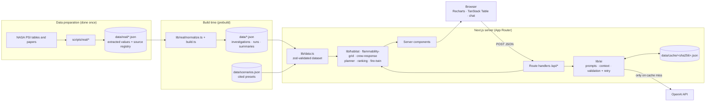

# FireSight

**What real NASA fire tests cover, and what they miss, for Moon and Mars habitats.**
NASA Space Apps Challenge 2026 · *Flame in Freefall*

[](LICENSE)


Fire behaves differently in space. Without gravity, hot gas does not rise, so a flame burns as a slow blue sphere and depends on the airflow the crew controls. Future Moon and Mars cabins also plan to use **lower pressure and more oxygen** than the ISS, which makes materials easier to burn.

FireSight is an open-source web dashboard built on the combustion data NASA archives in **Physical Science Informatics (PSI)**, plus published results from the **Saffire IV–VI** flights. You pick a cabin atmosphere and it shows:

- which real experiments tested fuels at or near that air, and what happened
- what has **never** been tested there
- what crews did to put flames out, and whether it worked
- which tests NASA should fly next to close the gaps

> **Real data only.** 772 run-level tests: 764 from PSI tables (BASS, BASS-II, FLEX, CFI, Saffire I–III) and 8 hand-transcribed from NASA papers (Saffire IV–VI, marked "published paper"). Every value links back to the file and row it came from. Missing values stay missing. Nothing is generated or invented.

FireSight supports engineering judgment. It does **not** replace NASA flammability standards such as NASA-STD-6001, and must not be used for flight certification.

---
## Deployed website: [FireSight](https://firesight-gamma.vercel.app/)

## Contents

- [Pages: what each one does and how to use it](#pages)
- [Run it on your own computer](#run-it-on-your-own-computer)
- [Scripts](#scripts)
- [How it works](#how-it-works)
- [Data](#data)
- [Deploying](#deploying)
- [Limitations](#limitations)
- [Contributing](#contributing)
- [License and credits](#license-and-credits)

---

## Pages

Every page except Home starts with a short guide that names each section; click a guide item to jump to it. The AI layer (shown as **SI** in the app) needs an API key. Every other feature works without one. See [Environment variables](#3-optional-add-an-api-key-for-the-ai-features).

### Home `/`

**What it does:** An introduction to the problem. It shows the headline findings, each counted from the real runs when the page is built: how many solid-fuel runs exist at the lunar atmosphere, how often turning off the fans put a flame out, and how often a nitrogen jet did.

**How to use it:** Read top to bottom, then follow **Take the tour**. It visits each page in the order that tells the story best.

### Habitat Flammability Explorer `/habitat` (main feature)

**What it does:** Answers the question *"Is this cabin air dangerous, and has anyone actually tested it?"*

| Section | What you see |
| --- | --- |
| Cabin condition | Presets (ISS, lunar base, Mars transit and more) and sliders for oxygen (15–100%), pressure (3–15 psi), material, airflow and gravity. |
| Readouts and verdicts | O2 partial pressure, the change from Earth air, and a verdict for solid, liquid and gas fuels: **Tested**, **Near tested runs**, **Not tested** or **No run data**. |
| Coverage map | A grid of every cabin air from 15–51% O2 and 3–15 psi, coloured by what real runs recorded. Striped squares are untested. Click a square to move your cabin there. |
| Nearest experiments and gaps | The five real runs closest to your air, with their results and sources, and what no run in the data has reached. |
| SI explanation | A plain-language reading of this cabin with NASA sources and recommended tests. You can ask a follow-up question. |
| Fire Twin | A simulated fire in a cabin module. Light an item and follow ignition, smoke, alarm and crew response. Whether an item catches comes from real runs; spread and response times are illustrative. |
| Most relevant investigations | The NASA experiments that matter most for this air. Every score is shown, and you can change the weights. |

**How to use it:**
1. Pick a preset at the top, or set your own oxygen and pressure.
2. Read the verdict for each fuel type. "Near tested runs" means the closest real run is nearby but not at your exact air.
3. Check the coverage map and nearest runs to see the evidence. Click a run's investigation to trace it to its NASA source.
4. Scroll to **Fire Twin** and light an item to watch a scenario play out.

**Deep links:** `/habitat?preset=lunar-base`, `/habitat?preset=mars-transit`, `/habitat?preset=lunar-base#fire-twin`

### Crew Response Evidence `/response`

**What it does:** On a spacecraft, the first step when a fire starts is to stop the ventilation. This page collects every time a NASA crew turned the airflow down or off, or used a nitrogen jet, on a real flame in orbit, and what the test notes say happened next.

| Section | What you see |
| --- | --- |
| What the crew did | For each action (fans off, fans down, nitrogen jet, fans up), how often the flame went out, partly went out or kept burning. |
| Airflow map | Solid-fuel runs plotted by oxygen and airflow speed, coloured by result, to show which conditions were actually tested. |
| Every coded action | Each action in its own row, with the investigator's exact words, so every count can be checked. |
| What "extinguished" means | Splits extinguished flames by cause: a crew action, or the fuel running out. |
| Fires left to burn | Saffire's larger fires, burned with the airflow left on, and how long they burned. |
| How to read this page | What the evidence does not show, and how the notes were coded. |

**How to use it:** Start with the tally to see which action works best, then open **Every coded action** to read the notes behind any number you want to check.

### Experiment Planner `/planner`

**What it does:** Answers *"Which fire tests should NASA fly next?"* You choose the Moon or Mars cabin air you need to be sure about and how many tests you can afford. FireSight places each new test where it closes the most untested ground, building out from the real NASA runs.

| Section | What you see |
| --- | --- |
| Plan the campaign | Mission atmospheres, material, test budget, and whether tests must stay one safe step from existing evidence. |
| Before and after | Each mission's coverage now and after the plan (for example, *Near tested → Tested after test 1*). |
| The campaign on the map | Real runs, mission targets and the numbered proposed tests, with arrows from the evidence each test builds on. Toggle before and after. |
| Proposed tests | Each test's oxygen, pressure and partial pressure, why it was chosen, the runs it builds on, flown hardware at that pressure, and any flags. |
| Experiment proposal | One click has the SI write a cited proposal. **Copy as Markdown** exports the whole plan with sources. |

**How to use it:** Choose missions and a budget, check the before/after verdicts, then look at the map to see where the tests land. Export the plan when you are happy with it.

### Investigation Explorer `/explore`

**What it does:** The source of truth. Shows all 20 NASA combustion investigations and every real run behind the other pages.

| Section | What you see |
| --- | --- |
| Investigations table | Search, filter (fuel category, data held, hardware, safety pillar, O2 range) and sort any column. |
| Investigation detail | Click a row to see the original PSI record, every test run with its exact source (sheet and row, or paper, table and page), the citation (DOI, licence), known data issues and an SI summary. |
| Compare mode | Pick 2–4 investigations to plot their runs on one chart and read an SI comparison. |
| Then vs Now (tab) | Real spacecraft fires, from Apollo 1 to Mir, and the experiments NASA ran afterwards, with sources. |

**Deep links:** `/explore?id=saffire-iv-vi` opens one record, `/explore?tab=history` opens Then vs Now.

### Ask the Data `/ask`

**What it does:** Plain-English questions about the records. Each question retrieves the six most relevant investigations with their run statistics, and the SI answers **only** from those, citing investigation and run ids. It says so when the data does not cover a question.

**How to use it:** Click a starter question or type your own, for example *"Which solid fuels were tested below 10 psi?"*. Check the cited ids in the Explorer.

### Back on Earth `/earth`

**What it does:** What each investigation says it means for life on Earth (smoke detectors, suppression systems, firefighter gear, cleaner combustion), quoted from the "Research Impacts/Earth Benefits" field of each PSI record and grouped by keyword.

**How to use it:** Jump to a group from the links at the top. Click an acronym to open that investigation in the Explorer, or **PSI record** to see NASA's page.

---

## Run it on your own computer

### 1. Install the prerequisites

- **Node.js 20.9 or newer** (22 LTS recommended), which includes npm. Download it from [nodejs.org](https://nodejs.org/). Check your version with `node -v`.
- **Git**, from [git-scm.com](https://git-scm.com/).

### 2. Get the code and install dependencies

```bash
git clone https://github.com/Architbh007/Nasa_Hack_2026.git
cd Nasa_Hack_2026
npm install
```

### 3. (Optional) Add an API key for the AI features

Copy the example environment file:

```bash
# macOS / Linux / Git Bash
cp .env.example .env.local

# Windows PowerShell
Copy-Item .env.example .env.local
```

Then open `.env.local` and fill in the values:

| Variable | Default | Purpose |
| --- | --- | --- |
| `OPENAI_API_KEY` | (none) | Used only by server-side route handlers. Never sent to the browser. |
| `MODEL_MAIN` | `gpt-6.1-sol` | Summaries, comparisons, habitat interpretation, planner proposals, Q&A. |
| `MODEL_FAST` | `gpt-6-luna` | Fire Twin narration and Then vs Now lessons. |
| `USE_CACHE_ONLY` | `false` | When `true`, never call the API and serve cached outputs from `data/cache` only. |

**You can skip this step.** The dataset is committed, so every chart, map, table, verdict and the Fire Twin work without a key. AI panels show "SI unavailable" unless their answer is already cached in `data/cache`. `.env.local` is git-ignored; never commit a real key.

### 4. Start the app

```bash
npm run dev
```

Open [http://localhost:3000](http://localhost:3000).

### 5. (Optional) Production build

```bash
npm run build    # rebuilds and validates the dataset first, then builds Next.js
npm start        # serves the production build on http://localhost:3000
```

### Troubleshooting

- **`npm install` fails or the app will not start:** check `node -v` is 20.9 or newer.
- **Port 3000 is in use:** run `npm run dev -- -p 3001`.
- **`npm test` on Windows:** always use `npm test` rather than calling vitest directly. `scripts/run-vitest.mjs` upper-cases the drive letter, because vitest fails on paths like `c:\...`.
- **AI panels say "SI unavailable":** add `OPENAI_API_KEY` to `.env.local` and restart the dev server, or run `npm run prewarm` once to cache answers.

---

## Scripts

| Command | What it does |
| --- | --- |
| `npm run dev` | Development server with hot reload. |
| `npm run build` / `npm start` | Production build (runs `prebuild` first) and production server. |
| `npm run build:data` | Normalizes `data/real/*.json` into `data/investigations.json`, `runs.json` and `summaries.json`. Checks unit conversions and cross-file facts, and writes nothing if any check fails. Runs automatically before every build. |
| `npm run fetch:psi` | Refreshes `data/real/psi-investigations.json` from the PSI search service. |
| `npm run prewarm` | Generates and caches AI outputs for a demo (needs an API key). `npm run prewarm -- --core` limits it to the core set. |
| `npm test` | Vitest suites: provenance, no invented outcomes, unit conversions, normalizers on real fixtures, coverage, ranking, similarity, crew response, planner, retrieval, and the AI pipeline with a mocked client. |
| `npm run lint` / `npm run typecheck` | ESLint and `tsc --noEmit`. |

---

## How it works



- **No database.** Data lives in versioned JSON files, imported statically and validated once with zod.
- **One assessment function.** `assessHabitat` in `lib/habitat.ts` feeds the page, the AI route and the prewarm script, so the AI sees exactly what the user sees.
- **AI runs on the server only.** Structured calls ask for JSON, validate it with zod and retry once. Prompts require citing investigation and run ids, naming missing fields, and forbid predictions.
- **Caching.** AI results are cached by a sha256 of kind, model, prompt version and input, so changing the data or a prompt invalidates them.

### Project structure

```
app/            pages (habitat, response, planner, explore, ask, earth) and app/api/* route handlers
components/     ui/ (shadcn) plus one folder per page, and shared shell, si, charts, common
lib/            schema, data loading, validation, habitat, flammability grid, crew response,
                planner, fire twin, ranking, similarity, search, ai/
lib/real/       per-dataset normalizers and investigation assembly
data/real/      extracted NASA values, PSI metadata, citations, source registry
data/           built investigations.json, runs.json, summaries.json, scenarios.json, cache/
scripts/        build-data, prewarm-cache, real/ (extractors and PSI fetch)
tests/          vitest suites
public/images/  NASA photographs (credited on each page)
```

---

## Data

`lib/schema.ts` is the contract.

- **Runs** (`runs.json`): one record per real test. Nearly every value can be missing. Each run records `dataSource` (`psi` or `published`), `sourceKind` (`psi-table` or `paper`) and `source: { file, ref }`. Outcomes carry a basis: `source-field` (a table column), `notes-keyword` (read from investigator notes and reviewed by a person) or `none` ("not stated").
- **Pressure.** `pressureStatus` is `measured`, `paper` or `not-recorded`. BASS-II records no pressure, so a cited ISS nominal (14.7 psi) is kept in a separate `pressureAssumedPsi` field and drawn as a hollow marker. It is never stored as a measured value.
- **Investigations** (`investigations.json`): built from PSI metadata, DataCite citations and licences, and known issues from the source registry. O2, pressure and flow ranges come from run-level data only.
- **Scenarios** (`scenarios.json`): each preset cites its atmosphere source. The lunar preset (34% O2 at 8.2 psi) cites NTRS 20170000230, page 7.
- **Build-time checks** (`lib/validate.ts`): provenance on every run, outcomes only with a basis, no measured pressure where none was recorded, psi vs kPa agreement, and source unit conversions.

Sources and reuse terms are listed in `data/real/source-registry.json`. 16 of the 19 PSI investigations list CC0 1.0 in DataCite; PSI-10, PSI-20 and PSI-22 list no licence.

---


## Limitations

- **Coverage, not prediction.** Verdicts compare atmospheres only. FireSight does not estimate ignition probability or flame spread.
- **Gravity.** Every run is in microgravity. Lunar and Mars gravity are not represented in the data.
- **Outcomes.** Some outcomes are keyword reads of investigator notes (labelled as such); many are not stated in the source.
- **Fire Twin.** Whether an item ignites comes from real runs. Spread rates and response times are illustrative.
- **Saffire IV–VI.** Hand-transcribed from papers; a second check against the PDFs is still open.
- **AI output.** Constrained to the provided records, but it can still be wrong. Check the cited ids.

---

## Contributing

Issues and pull requests are welcome.

1. Fork the repo and create a branch from `main`.
2. Run `npm run lint`, `npm run typecheck` and `npm test` before opening a PR.
3. Any new data must carry its source (file and row, or paper, table and page). Do not add values without one.

---

## License and credits

The **source code** is released under the [MIT License](LICENSE).

The **NASA data and photographs** in this repo are not covered by the MIT License. They remain under their own terms: most PSI datasets are CC0 1.0 (see `data/real/source-registry.json` for each one), and NASA imagery follows [NASA's media usage guidelines](https://www.nasa.gov/nasa-brand-center/images-and-media/). Credit for the data goes to NASA and the investigators named in each record.

Built for the 2026 NASA Space Apps Challenge. This project is not affiliated with or endorsed by NASA.

Built with Next.js 16 (App Router), React 19, TypeScript, Tailwind CSS, shadcn/ui, Recharts, TanStack Table, zod, fuse.js and the OpenAI TypeScript SDK.
