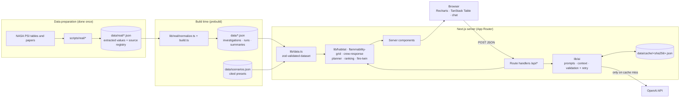

# FireSight

**What real NASA fire tests cover, and what they miss, for Moon and Mars habitats.**
NASA Space Apps Challenge 2026 · *Flame in Freefall*

[](LICENSE)


Fire behaves differently in space. Without gravity, hot gas does not rise, so a flame burns as a slow blue sphere and depends on the airflow the crew controls. Future Moon and Mars cabins also plan to use **lower pressure and more oxygen** than the ISS, which makes materials easier to burn.

FireSight is an open-source web dashboard built on the combustion data NASA archives in **Physical Science Informatics (PSI)**, plus published results from the **Saffire IV–VI** flights. You pick a cabin atmosphere and it shows:

- which real experiments tested fuels at or near that air, and what happened
- what has **never** been tested there
- what crews did to put flames out, and whether it worked
- which tests NASA should fly next to close the gaps

> **Real data only.** 772 run-level tests: 764 from PSI tables (BASS, BASS-II, FLEX, CFI, Saffire I–III) and 8 hand-transcribed from NASA papers (Saffire IV–VI, marked "published paper"). Every value links back to the file and row it came from. Missing values stay missing. Nothing is generated or invented.

FireSight supports engineering judgment. It does **not** replace NASA flammability standards such as NASA-STD-6001, and must not be used for flight certification.

---
## Deployed website: [FireSight](https://firesight-gamma.vercel.app/)

## Contents

- [Pages: what each one does and how to use it](#pages)
- [Run it on your own computer](#run-it-on-your-own-computer)
- [Scripts](#scripts)
- [How it works](#how-it-works)
- [Data](#data)
- [Deploying](#deploying)
- [Limitations](#limitations)
- [Sources](#sources)
- [Contributing](#contributing)
- [License and credits](#license-and-credits)

---

## Pages

FireSight has seven pages. Six are interactive and one is an introduction.

| Page | Route | Sections | What it is for |
| --- | --- | --- | --- |
| Home | `/` | 3 headline findings + a guided tour | The story, in numbers counted from the data |
| Habitat Flammability Explorer | `/habitat` | 8 | Is this cabin air covered by real tests? (main feature) |
| Crew Response Evidence | `/response` | 6 | What crews did to put flames out, and whether it worked |
| Experiment Planner | `/planner` | 5 | Which tests NASA should fly next |
| Investigation Explorer | `/explore` | 4 | The source of truth: every investigation and run |
| Ask the Data | `/ask` | 1 (chat) | Plain-English questions answered from the records |
| Back on Earth | `/earth` | grouped list | What the research means for life on Earth |

Every page except Home starts with a short guide that names each section; click a guide item to jump to it. The AI layer (shown as **SI** in the app) needs an API key. Every other feature works without one. See [Environment variables](#3-optional-add-an-api-key-for-the-ai-features).

### Home `/`

**What it does:** An introduction to the problem. It shows the headline findings, each counted from the real runs when the page is built: how many solid-fuel runs exist at the lunar atmosphere, how often turning off the fans put a flame out, and how often a nitrogen jet did.

**How to use it:** Read top to bottom, then follow **Take the tour**. It visits each page in the order that tells the story best.

### Habitat Flammability Explorer `/habitat` (main feature)

**What it does:** Answers the question *"Is this cabin air dangerous, and has anyone actually tested it?"*

| Section | What you see |
| --- | --- |
| Cabin condition | Presets (ISS, lunar base, Mars transit and more) and sliders for oxygen (15–100%), pressure (3–15 psi), material, airflow and gravity. |
| Readouts and verdicts | O2 partial pressure, the change from Earth air, and a verdict for solid, liquid and gas fuels: **Tested**, **Near tested runs**, **Not tested** or **No run data**. |
| Coverage map | A grid of every cabin air from 15–51% O2 and 3–15 psi, coloured by what real runs recorded. Striped squares are untested. Click a square to move your cabin there. |
| Nearest experiments and gaps | The five real runs closest to your air, with their results and sources, and what no run in the data has reached. |
| SI explanation | A plain-language reading of this cabin with NASA sources and recommended tests. You can ask a follow-up question. |
| Fire Twin | A simulated fire in a cabin module. Light an item and follow ignition, smoke, alarm and crew response. Whether an item catches comes from real runs; spread and response times are illustrative. |
| Lower the oxygen? (O2 comparison) | *"If a fire starts, would cutting the oxygen put it out?"* Drag a two-handled slider (0–31% O2, same pressure) to put a **before** air next to an **after** air. Each side shows what real runs recorded there, a flame estimate, and what the crew would breathe. See [O2 comparison](#o2-comparison-lower-the-oxygen) below. |
| Most relevant investigations | The NASA experiments that matter most for this air. Every score is shown, and you can change the weights. |

**How to use it:**
1. Pick a preset at the top, or set your own oxygen and pressure.
2. Read the verdict for each fuel type. "Near tested runs" means the closest real run is nearby but not at your exact air.
3. Check the coverage map and nearest runs to see the evidence. Click a run's investigation to trace it to its NASA source.
4. Scroll to **Fire Twin** and light an item to watch a scenario play out.

**Deep links:** `/habitat?preset=lunar-base`, `/habitat?preset=mars-transit`, `/habitat?preset=lunar-base#fire-twin`, `/habitat#lower-o2`

**Behind the scenes:** Airs are compared by distance, `√((ΔO2/10)² + (Δpsi/3)²)`. A fuel category is **Tested** with a run within ±2% O2 and ±1 psi, and **Near** within distance 0.6. The 12 × 12 map, ranking and Fire Twin all reuse this measure (`lib/metrics.ts`, `lib/habitat.ts`).

#### O2 comparison ("Lower the oxygen?")

**What it does:** Answers the most common instinct in a fire, *"can we just lower the oxygen?"* You set a **before** O2 and an **after** O2 (same pressure, same fuel category as the page) and FireSight shows four things side by side:

| Part | What you see | How it is made |
| --- | --- | --- |
| Real runs at each air | "*N* of *M* real runs had a flame", how many did not ignite, how many state no result, and how many went out when the airflow was turned down or off. If no run sits at that air, the closest runs that state a result are listed with their distance. | `lowerOxygenCheck`: same-category runs within ±2% O2 and ±1 psi. Flow-linked extinctions are keyword matches on investigator notes. |
| Flame estimate | A reading ("Likely to burn", "May burn", "Can't tell from the data"), a percentage with a 90% range and a confidence level, always labelled **Estimate, not a test**. | `estimateFlame`: nearby real runs vote with distance-based weights into a Beta-Binomial estimate (90% range). It declines when too far from any run. |
| What the crew breathes | O2 partial pressure and a band: *Fine to breathe*, *Like a mountain town*, *Hypoxia likely*, *Dangerous for crew*. | Standard-atmosphere arithmetic, not data: pO2 converted to an equivalent Earth altitude, then banded. |
| SI explanation | A short written comparison: answer, what changes, what you would see, crew, and the better response. | `POST /api/lower-oxygen`: the server recomputes every number, and the SI must cite run ids. |

**How to use it:** Drag the handles (right = air before, left = air after lowering). Read the real-run counts first, then the estimate, then the crew box. The investigator quotes underneath show what was written about the flame at the lower air.

> The estimate is a statistical summary of the same real runs, not extra data. Almost every real run in the dataset recorded a flame (only 6 of 772 recorded "no ignition"), so the estimate is high wherever runs exist. Use it as a reading of the evidence, not as a safety margin.

### Crew Response Evidence `/response`

**What it does:** On a spacecraft, the first step when a fire starts is to stop the ventilation. This page collects every time a NASA crew turned the airflow down or off, or used a nitrogen jet, on a real flame in orbit, and what the test notes say happened next.

| Section | What you see |
| --- | --- |
| What the crew did | For each action (fans off, fans down, nitrogen jet, fans up), how often the flame went out, partly went out or kept burning. |
| Airflow map | Solid-fuel runs plotted by oxygen and airflow speed, coloured by result, to show which conditions were actually tested. |
| Every coded action | Each action in its own row, with the investigator's exact words, so every count can be checked. |
| What "extinguished" means | Splits extinguished flames by cause: a crew action, or the fuel running out. |
| Fires left to burn | Saffire's larger fires, burned with the airflow left on, and how long they burned. |
| How to read this page | What the evidence does not show, and how the notes were coded. |

**How to use it:** Start with the tally to see which action works best, then open **Every coded action** to read the notes behind any number you want to check.

**Behind the scenes:** The 75 events are hand-coded from BASS notes, each with the investigator's exact quote (`data/real/crew-response-coding.json`). The page only counts them and joins them to their runs. Nothing is predicted. A second person still has to verify the coding.

### Experiment Planner `/planner`

**What it does:** Answers *"Which fire tests should NASA fly next?"* You choose the Moon or Mars cabin air you need to be sure about and how many tests you can afford. FireSight places each new test where it closes the most untested ground, building out from the real NASA runs.

| Section | What you see |
| --- | --- |
| Plan the campaign | Mission atmospheres, material, test budget, and whether tests must stay one safe step from existing evidence. |
| Before and after | Each mission's coverage now and after the plan (for example, *Near tested → Tested after test 1*). |
| The campaign on the map | Real runs, mission targets and the numbered proposed tests, with arrows from the evidence each test builds on. Toggle before and after. |
| Proposed tests | Each test's oxygen, pressure and partial pressure, why it was chosen, the runs it builds on, flown hardware at that pressure, and any flags. |
| Experiment proposal | One click has the SI write a cited proposal. **Copy as Markdown** exports the whole plan with sources. |

**How to use it:** Choose missions and a budget, check the before/after verdicts, then look at the map to see where the tests land. Export the plan when you are happy with it.

**Behind the scenes:** A deterministic greedy search over a 1% O2 × 0.5 psi lattice. Each test goes where it most shortens the distance from open missions to existing evidence. In stepping mode it stays within distance 0.6 of evidence (`lib/planner.ts`).

### Investigation Explorer `/explore`

**What it does:** The source of truth. Shows all 20 NASA combustion investigations and every real run behind the other pages.

| Section | What you see |
| --- | --- |
| Investigations table | Search, filter (fuel category, data held, hardware, safety pillar, O2 range) and sort any column. |
| Investigation detail | Click a row to see the original PSI record, every test run with its exact source (sheet and row, or paper, table and page), the citation (DOI, licence), known data issues and an SI summary. |
| Compare mode | Pick 2–4 investigations to plot their runs on one chart and read an SI comparison. |
| Then vs Now (tab) | Real spacecraft fires, from Apollo 1 to Mir, and the experiments NASA ran afterwards, with sources. |

**Deep links:** `/explore?id=saffire-iv-vi` opens one record, `/explore?tab=history` opens Then vs Now.

**Behind the scenes:** TanStack Table with fuse.js fuzzy search. The O2, pressure and flow ranges shown are computed from each investigation's runs, never typed in (`lib/real/build.ts`).

### Ask the Data `/ask`

**What it does:** Plain-English questions about the records. Each question retrieves the six most relevant investigations with their run statistics, and the SI answers **only** from those, citing investigation and run ids. It says so when the data does not cover a question.

**How to use it:** Click a starter question or type your own, for example *"Which solid fuels were tested below 10 psi?"*. Check the cited ids in the Explorer.

**Behind the scenes:** Each investigation is scored on fuzzy match, keyword overlap and small boosts for fuel, atmosphere or safety-pillar words. The top six go to the SI, which can only cite ids it was given (`lib/ai/retrieval.ts`).

### Back on Earth `/earth`

**What it does:** What each investigation says it means for life on Earth (smoke detectors, suppression systems, firefighter gear, cleaner combustion), quoted from the "Research Impacts/Earth Benefits" field of each PSI record and grouped by keyword.

**How to use it:** Jump to a group from the links at the top. Click an acronym to open that investigation in the Explorer, or **PSI record** to see NASA's page.

---

## Run it on your own computer

### 1. Install the prerequisites

- **Node.js 20.9 or newer** (22 LTS recommended), which includes npm. Download it from [nodejs.org](https://nodejs.org/). Check your version with `node -v`.
- **Git**, from [git-scm.com](https://git-scm.com/).

### 2. Get the code and install dependencies

```bash
git clone https://github.com/Architbh007/Nasa_Hack_2026.git
cd Nasa_Hack_2026
npm install
```

### 3. (Optional) Add an API key for the AI features

Copy the example environment file:

```bash
# macOS / Linux / Git Bash
cp .env.example .env.local

# Windows PowerShell
Copy-Item .env.example .env.local
```

Then open `.env.local` and fill in the values:

| Variable | Default | Purpose |
| --- | --- | --- |
| `OPENAI_API_KEY` | (none) | Used only by server-side route handlers. Never sent to the browser. |
| `MODEL_MAIN` | `gpt-6.1-sol` | Summaries, comparisons, habitat interpretation, planner proposals, Q&A. |
| `MODEL_FAST` | `gpt-6-luna` | Fire Twin narration and Then vs Now lessons. |
| `USE_CACHE_ONLY` | `false` | When `true`, never call the API and serve cached outputs from `data/cache` only. |

**You can skip this step.** The dataset is committed, so every chart, map, table, verdict and the Fire Twin work without a key. AI panels show "SI unavailable" unless their answer is already cached in `data/cache`. `.env.local` is git-ignored; never commit a real key.

### 4. Start the app

```bash
npm run dev
```

Open [http://localhost:3000](http://localhost:3000).

### 5. (Optional) Production build

```bash
npm run build    # rebuilds and validates the dataset first, then builds Next.js
npm start        # serves the production build on http://localhost:3000
```

### Troubleshooting

- **`npm install` fails or the app will not start:** check `node -v` is 20.9 or newer.
- **Port 3000 is in use:** run `npm run dev -- -p 3001`.
- **`npm test` on Windows:** always use `npm test` rather than calling vitest directly. `scripts/run-vitest.mjs` upper-cases the drive letter, because vitest fails on paths like `c:\...`.
- **AI panels say "SI unavailable":** add `OPENAI_API_KEY` to `.env.local` and restart the dev server, or run `npm run prewarm` once to cache answers.

---

## Scripts

| Command | What it does |
| --- | --- |
| `npm run dev` | Development server with hot reload. |
| `npm run build` / `npm start` | Production build (runs `prebuild` first) and production server. |
| `npm run build:data` | Normalizes `data/real/*.json` into `data/investigations.json`, `runs.json` and `summaries.json`. Checks unit conversions and cross-file facts, and writes nothing if any check fails. Runs automatically before every build. |
| `npm run fetch:psi` | Refreshes `data/real/psi-investigations.json` from the PSI search service. |
| `npm run prewarm` | Generates and caches AI outputs for a demo (needs an API key). `npm run prewarm -- --core` limits it to the core set. |
| `npm test` | Vitest suites: provenance, no invented outcomes, unit conversions, normalizers on real fixtures, coverage, ranking, similarity, crew response, planner, retrieval, and the AI pipeline with a mocked client. |
| `npm run lint` / `npm run typecheck` | ESLint and `tsc --noEmit`. |

---

## How it works



- **No database.** Data lives in versioned JSON files, imported statically and validated once with zod.
- **One assessment function.** `assessHabitat` in `lib/habitat.ts` feeds the page, the AI route and the prewarm script, so the AI sees exactly what the user sees.
- **AI runs on the server only.** Structured calls ask for JSON, validate it with zod and retry once. Prompts require citing investigation and run ids, naming missing fields, and forbid predictions.
- **Caching.** AI results are cached by a sha256 of kind, model, prompt version and input, so changing the data or a prompt invalidates them.
- **Evidence first.** Every verdict, count, distance and estimate is computed by plain TypeScript from the dataset. The SI only explains numbers it is handed, and its answers are validated with zod so they may cite only ids that were provided.

### Project structure

```
app/            pages (habitat, response, planner, explore, ask, earth) and app/api/* route handlers
components/     ui/ (shadcn) plus one folder per page, and shared shell, si, charts, common
lib/            schema, data loading, validation, habitat, flammability grid, crew response,
                planner, fire twin, ranking, similarity, search, ai/
lib/real/       per-dataset normalizers and investigation assembly
data/real/      extracted NASA values, PSI metadata, citations, source registry
data/           built investigations.json, runs.json, summaries.json, scenarios.json, cache/
scripts/        build-data, prewarm-cache, real/ (extractors and PSI fetch)
tests/          vitest suites
public/images/  NASA photographs (credited on each page)
```

---

## Data

### How the data was collected

1. **PSI tables (764 runs).** A team member downloaded the experiment tables and reference files by hand from NASA's Physical Science Informatics site (`psi.nasa.gov`) on 14 Nov 2026. These are the spreadsheets NASA's investigators uploaded, one row per test. Investigation names, hardware, dates, objectives and publications came from the PSI site's own search endpoint (`npm run fetch:psi`), and citations and licences from DataCite (`scripts/real/fetch-citations.ts`).
2. **Extraction by script.** One extractor per dataset in `scripts/real/` (`extract-flex.ts`, `extract-cfi.ts`, `extract-bass.ts`, and so on) reads the raw spreadsheet and writes JSON to `data/real/`. Every value keeps the file and row it came from, so the extraction can be rerun and checked. The raw downloads are not committed (`data/raw/` is git-ignored).
3. **Hand transcription (8 runs).** Saffire IV–VI results come from published NASA papers, copied by hand with paper, table and page, and stored separately as `dataSource: "published"`.
4. **Hand coding (75 events).** The crew-response events were read from BASS as-run notes by team members and stored with the exact quote.
5. **Normalization and checks.** `npm run build:data` converts units (atm, mmHg and kPa to psi), derives each investigation's ranges from its runs, and runs the checks listed below. If any check fails nothing is written, so the app cannot build on bad data.
6. **Nothing filled in.** A value the source did not record stays `null`. The one exception is the ISS cabin pressure (14.7 psi, cited) used to place BASS-II runs on the map, which is stored in its own field and drawn differently.

### The numbers

| | |
| --- | --- |
| Investigations covered | **20** (8 with run-level data, 1 planned test matrix, 1 day-level summary, 1 log summary, 1 schedule, 8 with metadata only) |
| Run-level tests | **772**: 764 from PSI tables and 8 from published papers |
| By investigation | FLEX 274 · CFI 227 · BASS-II 129 · BASS 121 · Saffire-II 9 · Saffire IV–VI 8 · Saffire-I 2 · Saffire-III 2 |
| By fuel category | 501 liquid-fuel droplets · 271 solid materials (102 plastic, 58 fabric, 111 not classified) · 0 gas |
| Oxygen range | 12–34% O2 (769 runs record oxygen) |
| Pressure | 621 measured, 21 from a paper, 130 not recorded (BASS-II, placed at the cited 14.7 psi) |
| Outcomes | 406 from a table column, 102 read from investigator notes and reviewed, 264 not stated |
| Outcome mix | 274 extinguished · 120 cool flame · 61 disruption · 39 burned · 8 blowoff · 6 no ignition · 264 not stated |
| Crew-response events | **75**, hand-coded from BASS notes |
| Presets | **5**, each citing its atmosphere source: Earth sea level, ISS cabin, lunar base (34% O2, 8.2 psi), Mars transit (26.5% O2, 10.2 psi), spacesuit (100% O2, 4.3 psi) |
| Coverage grid | **144** squares (12 × 12) |
| Automated tests | **139** across 13 suites |

Two numbers explain most of what you will see in the app. First, **solids were almost all tested at cabin air**: 262 of the 268 solid runs with a known oxygen level sit at 23% O2 or less and about 14.7 psi. The only 6 solid runs above 25% O2 or below 11 psi are the Saffire IV–VI samples, so most of the solid-fuel map for Moon and Mars air is untested. Second, **only 6 of 772 runs record "no ignition"**, because most experiments were designed to light a flame. This is why FireSight reports coverage and not safety.

### Schema and checks

`lib/schema.ts` is the contract.

- **Runs** (`runs.json`): one record per real test. Nearly every value can be missing. Each run records `dataSource` (`psi` or `published`), `sourceKind` (`psi-table` or `paper`) and `source: { file, ref }`. Outcomes carry a basis: `source-field` (a table column), `notes-keyword` (read from investigator notes and reviewed by a person) or `none` ("not stated").
- **Pressure.** `pressureStatus` is `measured`, `paper` or `not-recorded`. BASS-II records no pressure, so a cited ISS nominal (14.7 psi) is kept in a separate `pressureAssumedPsi` field and drawn as a hollow marker. It is never stored as a measured value.
- **Investigations** (`investigations.json`): built from PSI metadata, DataCite citations and licences, and known issues from the source registry. O2, pressure and flow ranges come from run-level data only.
- **Scenarios** (`scenarios.json`): each preset cites its atmosphere source. The lunar preset (34% O2 at 8.2 psi) cites NTRS 20170000230, page 7.
- **Build-time checks** (`lib/validate.ts`): provenance on every run, outcomes only with a basis, no measured pressure where none was recorded, psi vs kPa agreement, and source unit conversions.

Sources and reuse terms are listed in `data/real/source-registry.json`. 16 of the 19 PSI investigations list CC0 1.0 in DataCite; PSI-10, PSI-20 and PSI-22 list no licence.

---


## Limitations

- **Coverage, not prediction.** Verdicts compare atmospheres only. FireSight does not predict flame spread or certify any atmosphere as safe.
- **Flame estimate.** The only probability in the app is the "Estimate, not a test" panel in *Lower the oxygen?*. It is a statistical summary of real runs. Almost all of them recorded a flame (6 of 772 did not), so it cannot show where a flame stops, and it is labelled as an extrapolation below the lowest tested O2.
- **Crew line.** The breathing bands in *Lower the oxygen?* come from standard-atmosphere arithmetic, not from FireSight's data, and are not medical guidance.
- **Gravity.** Every run is in microgravity. Lunar and Mars gravity are not represented in the data.
- **Outcomes.** Some outcomes are keyword reads of investigator notes (labelled as such); many are not stated in the source.
- **Fire Twin.** Whether an item ignites comes from real runs. Spread rates and response times are illustrative.
- **Saffire IV–VI.** Hand-transcribed from papers; a second check against the PDFs is still open.
- **AI output.** Constrained to the provided records, but it can still be wrong. Check the cited ids.

---

## Sources

Every dataset, paper, web page, image, tool and service FireSight uses. The same list is kept in [`data/sources/SOURCES.md`](data/sources/SOURCES.md). Data was accessed on 14 Nov 2026.

How each dataset was extracted and checked is recorded in [`data/real/source-registry.json`](data/real/source-registry.json), and the per-investigation citation text is in [`data/real/citations.json`](data/real/citations.json).

### NASA data: run-level tests (772 runs)

| Source | Used for | Link |
| --- | --- | --- |
| NASA Physical Science Informatics (PSI) Repository | Home of every PSI dataset below | https://psi.nasa.gov |
| PSI-26 BASS (Burning and Suppression of Solids), DOI 10.60555/58h4-dy80 | 121 solid-fuel runs | https://psi.nasa.gov/physci/repo/data/investigations/PSI-26 |
| PSI-25 BASS-II, DOI 10.60555/4qc4-de67 | 129 solid-fuel runs | https://psi.nasa.gov/physci/repo/data/investigations/PSI-25 |
| PSI-69 FLEX (Flame Extinguishment Experiment), DOI 10.60555/mbq8-0451 | 274 liquid-droplet runs | https://psi.nasa.gov/physci/repo/data/investigations/PSI-69 |
| PSI-39 CFI (Cool Flames Investigation), DOI 10.60555/m6pj-a914 | 227 liquid-droplet runs | https://psi.nasa.gov/physci/repo/data/investigations/PSI-39 |
| PSI-98 Saffire-I, DOI 10.60555/0t15-1z43 | 2 runs | https://psi.nasa.gov/physci/repo/data/investigations/PSI-98 |
| PSI-99 Saffire-II, DOI 10.60555/2chp-m469 | 9 runs | https://psi.nasa.gov/physci/repo/data/investigations/PSI-99 |
| PSI-100 Saffire-III, DOI 10.60555/040q-4h36 | 2 runs | https://psi.nasa.gov/physci/repo/data/investigations/PSI-100 |
| Preliminary Results from the Saffire VI Experiment (ICES-2024-365), NTRS 20240002981 | Saffire IV–VI runs (Tables 1 and 2) | https://ntrs.nasa.gov/citations/20240002981 |
| Preliminary Results from the Saffire VI Experiment, slide deck, NTRS 20240007488 | Saffire VI test matrix (slide 11) | https://ntrs.nasa.gov/api/citations/20240007488/downloads/Saffire%20ICES%202024%20Saffire%20presentation072124small.pdf |
| Fire Safety Implications of Preliminary Results from Saffire IV and V Experiments on Large Scale Spacecraft Fires (ICES 2021-266), NTRS 20210011521 | Saffire IV–V runs (Tables 1 and 2) | https://ntrs.nasa.gov/citations/20210011521 |
| Spacecraft Fire Safety Demonstration (Saffire) overview | Saffire flight dates and goals | https://www.nasa.gov/wp-content/uploads/2025/07/spacecraft-fire-safety-demonstration-saffire.pdf |

### NASA data: summaries and metadata (shown in the Explorer)

| Source | Data held | Link |
| --- | --- | --- |
| PSI-68 FLEX-2, DOI 10.60555/byp8-h018 | Planned test matrix | https://psi.nasa.gov/physci/repo/data/investigations/PSI-68 |
| PSI-20 ACME BRE | Day-level summary | https://psi.nasa.gov/physci/repo/data/investigations/PSI-20 |
| PSI-107 SPICE, DOI 10.60555/9kbh-e962 | Log summary | https://psi.nasa.gov/physci/repo/data/investigations/PSI-107 |
| PSI-106 SLICE, DOI 10.60555/pm12-rg61 | Schedule | https://psi.nasa.gov/physci/repo/data/investigations/PSI-106 |
| PSI-10 ACME Flame Design, DOI 10.60555/w4zy-bt45 | Metadata only | https://psi.nasa.gov/physci/repo/data/investigations/PSI-10 |
| PSI-21 ACME CLD Flame, DOI 10.60555/23e1-9950 | Metadata only | https://psi.nasa.gov/physci/repo/data/investigations/PSI-21 |
| PSI-22 ACME E-FIELD Flames | Metadata only | https://psi.nasa.gov/physci/repo/data/investigations/PSI-22 |
| PSI-23 ACME s-Flame, DOI 10.60555/k57n-p030 | Metadata only | https://psi.nasa.gov/physci/repo/data/investigations/PSI-23 |
| PSI-159 ACME CFI-G, DOI 10.60555/cyt1-kh64 | Metadata only | https://psi.nasa.gov/physci/repo/data/investigations/PSI-159 |
| PSI-47 DAFT / DAFT-2, DOI 10.60555/ztgj-d202 | Metadata only | https://psi.nasa.gov/physci/repo/data/investigations/PSI-47 |
| PSI-101 SAME-R, DOI 10.60555/2np7-jv14 | Metadata only | https://psi.nasa.gov/physci/repo/data/investigations/PSI-101 |
| PSI-102 SAME, DOI 10.60555/gd4k-8h62 | Metadata only | https://psi.nasa.gov/physci/repo/data/investigations/PSI-102 |
| PSI combustion-science search endpoint | Names, hardware, dates, objectives and publications for all 20 investigations | https://psi.nasa.gov/geode-py/ws/repo/search?data_source=psi&data_type=investigation&ffield=Research%20Area&fvalue=combustion%20science&size=200 |

### NASA references: cabin atmosphere presets

| Source | Used for | Link |
| --- | --- | --- |
| NASA Man-Systems Integration Standards (MSIS), Section 5 | Earth sea-level preset (14.7 psia, about 21% O2) | https://msis.jsc.nasa.gov/sections/section05.htm |
| NASA OCHMO ECLSS Technical Brief (NASA-STD-3001) | ISS cabin preset and the 14.7 psi used to place BASS-II runs | https://www.nasa.gov/wp-content/uploads/2023/07/eclss-technical-brief-ochmo.pdf |
| Operation and Development Status of the Spacecraft Fire Experiments (Saffire), NTRS 20170000230 | Lunar base preset (34% O2, 8.2 psi, page 7) | https://ntrs.nasa.gov/citations/20170000230 |
| Effects of the 8 psia / 32% O2 Atmosphere on the Human in the Spaceflight Environment, NTRS 20130013505 | Mars transit preset (26.5% O2, 10.2 psia) | https://ntrs.nasa.gov/citations/20130013505 |
| Designing an Exploration Atmosphere Prebreathe Protocol, NTRS 20140012830 | Spacesuit preset (4.3 psia) | https://ntrs.nasa.gov/citations/20140012830 |

### NASA references: Then vs Now (historical fires)

| Source | Link |
| --- | --- |
| 55 Years Ago: The Apollo 1 Fire and its Aftermath | https://www.nasa.gov/history/55-years-ago-the-apollo-1-fire-and-its-aftermath/ |
| Apollo 1 mission page | https://www.nasa.gov/mission/apollo-1/ |
| NASA SP-350: Apollo Expeditions to the Moon, chapter 4 | https://history.nasa.gov/SP-350/ch-4-5.html |
| 25 Years Ago: Fire Aboard Space Station Mir | https://www.nasa.gov/history/25-years-ago-fire-aboard-space-station-mir/ |
| Particle and Smoke Detection on ISS for Next Generation Smoke Detectors, NTRS 20070031686 | https://ntrs.nasa.gov/citations/20070031686 |
| Detailed Results from the Flame Extinguishment Experiment (FLEX), NTRS 20150023456 | https://ntrs.nasa.gov/citations/20150023456 |
| Multi-User Droplet Combustion Apparatus: Flame Extinguishment Experiment, NTRS 20090014812 | https://ntrs.nasa.gov/citations/20090014812 |
| Burning and Suppression of Solids-II (BASS-II) Summary Report, NTRS 20210011385 | https://ntrs.nasa.gov/citations/20210011385 |
| Combustion of Solids in Microgravity: Results from the BASS-II Experiment, NTRS 20160000593 | https://ntrs.nasa.gov/citations/20160000593 |
| The Flame of Discovery Grows as Saffire Sets New Fires in Space | https://www.nasa.gov/humans-in-space/the-flame-of-discovery-grows-as-saffire-sets-new-fires-in-space/ |
| Moon to Mars (M2M): Exploration Atmosphere, NTRS 20240003211 | https://ntrs.nasa.gov/citations/20240003211 |
| Evidence Report: Risk of Hypobaric Hypoxia from the Exploration Atmosphere, NTRS 20150021491 | https://ntrs.nasa.gov/citations/20150021491 |

### NASA images

All photographs are NASA imagery, used under [NASA's media usage guidelines](https://www.nasa.gov/nasa-brand-center/images-and-media/) and searchable in the [NASA Image and Video Library](https://images.nasa.gov). No NASA logos are used.

| File (`public/images/`) | Page | NASA ID |
| --- | --- | --- |
| iss-module-night.jpg | Habitat | iss042e021318 |
| combustion-integrated-rack.jpg | Explorer | iss032e014574 |
| earth-night-aurora.jpg | Home, Back on Earth | iss058e005282 |
| earthset-over-moon.jpg | Planner | art002e021278 |
| flame-spread-solid-fuel.jpg | Crew Response | 9902618 |
| orbital-sunrise.jpg | Home | NASA (ID not recorded) |
| microgravity-candle-flame.jpg | Home | NASA (ID not recorded) |

### Other data and services

| Source | Used for | Link |
| --- | --- | --- |
| DataCite REST API | DOIs, citation text and licences for the PSI datasets | https://api.datacite.org |
| Creative Commons CC0 1.0 | Licence of 16 of the 19 PSI investigations | https://creativecommons.org/publicdomain/zero/1.0/ |
| OpenAI API | SI explanations inside the app (server-side, cached) | https://platform.openai.com |
| Claude Code | SI coding assistant used to write much of the code | https://www.anthropic.com/claude-code |
| Vercel | Hosting | https://vercel.com |

### Open-source code

| Tool | Link |
| --- | --- |
| Next.js | https://nextjs.org |
| React | https://react.dev |
| TypeScript | https://www.typescriptlang.org |
| Tailwind CSS | https://tailwindcss.com |
| shadcn/ui | https://ui.shadcn.com |
| Radix UI | https://www.radix-ui.com |
| Recharts | https://recharts.org |
| TanStack Table | https://tanstack.com/table |
| Zod | https://zod.dev |
| Fuse.js | https://www.fusejs.io |
| Lucide icons | https://lucide.dev |
| react-markdown and remark-gfm | https://github.com/remarkjs/react-markdown |
| ExcelJS (reading PSI spreadsheets) | https://github.com/exceljs/exceljs |
| Vitest | https://vitest.dev |
| tsx | https://github.com/privatenumber/tsx |
| Geist font | https://fonts.google.com/specimen/Geist |

---

## Contributing

Issues and pull requests are welcome.

1. Fork the repo and create a branch from `main`.
2. Run `npm run lint`, `npm run typecheck` and `npm test` before opening a PR.
3. Any new data must carry its source (file and row, or paper, table and page). Do not add values without one.

---

## License and credits

The **source code** is released under the [MIT License](LICENSE).

The **NASA data and photographs** in this repo are not covered by the MIT License. They remain under their own terms: most PSI datasets are CC0 1.0 (see `data/real/source-registry.json` for each one), and NASA imagery follows [NASA's media usage guidelines](https://www.nasa.gov/nasa-brand-center/images-and-media/). Credit for the data goes to NASA and the investigators named in each record.

Built for the 2026 NASA Space Apps Challenge. This project is not affiliated with or endorsed by NASA.

Built with Next.js 16 (App Router), React 19, TypeScript, Tailwind CSS, shadcn/ui, Recharts, TanStack Table, zod, fuse.js and the OpenAI TypeScript SDK.
