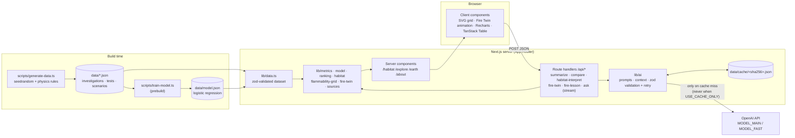

# FireSight

**Fire safety insight for crewed habitats, from microgravity combustion research.**
NASA Space Apps Challenge 2026 · *Flame in Freefall*

FireSight is a web dashboard that summarizes, ranks and interprets NASA Physical Science Informatics (PSI) combustion investigations for crewed habitats: ISS, Orion, a lunar surface base, pressurized rovers and Mars transit. Its centerpiece is the **Habitat Flammability Explorer**. You enter a proposed cabin atmosphere (oxygen % and total pressure), and it shows:

- where that point sits among tested microgravity combustion conditions
- which investigations cover it, and what is untested
- a predicted ignition likelihood from a small model trained on test-level runs

> **Synthetic demo data.** Investigation names, hardware and project groupings are real. Every number, test run, finding and measurement in this build is generated from a fixed seed. The app shows a persistent banner, and every record carries `dataSource: "synthetic"`. Do not cite any value here as a NASA result.

It supports engineering judgment. It does not replace NASA flammability standards such as NASA-STD-6001.

---

## Features

| Page | What it does |
| --- | --- |
| `/habitat` | **Main feature.** Presets and sliders for O2 (15–100%) and pressure (3–15 psi), plus material, airflow and gravity. Shows: readouts (pO2, O2 vs Earth, ignition gauge, KNN flame spread, covering records, gap flag); a 12 × 12 **flammability grid** (O2 vs pressure, coloured by the ignition model, striped where untested, with a material toggle and the nearest evidence runs on hover); an **SI explanation** with a plain-words summary and links to the original NASA sources, plus a small **ask-about-this-cabin** box; **Fire Twin**, an animated top-down cabin module where you start a fire and watch ignition, spread, smoke, detection and crew response (data-backed vs illustrative timings marked), with an SI narrator; an explainable ranking with weight sliders; a partial-gravity callout. |
| `/explore` | Two tabs. **Investigations:** TanStack table of 19 investigations with fuse.js search and filters (fuel phase, hardware, pillar, habitat relevance, O2 range); the detail sheet has the SI summary, variables vs constants, a test scatter and the original NASA source links; compare mode (2–4 records) adds a relevance radar, overlaid scatters and an SI comparison. **Then vs Now:** a timeline of real spaceflight fire history (Apollo 1, Mir, FLEX, BASS, Saffire, today's exploration atmosphere) from NASA sources, each linked to related investigations, with an SI lesson per event. |
| `/earth` | Earth applications grouped into suppression, smoke detection, firefighter gear, flammability standards and cleaner combustion. |
| `/about` | Data policy, generation rules, model card (features, coefficients, train and holdout accuracy), ranking method, flammability grid and Fire Twin methods (including every illustrative assumption), SI layer. |

Deep links that help in demos:
- `/habitat?preset=lunar-base`
- `/explore?id=bass-ii`
- `/explore?compare=bass,bass-ii,saffire-ii`
- `/explore?tab=history`

---

## Quick start

Prerequisites: Node.js 20.9 or newer (22 recommended), npm. No GPU, no database; it runs comfortably on an 8 GB laptop.

```bash
npm install
cp .env.example .env.local      # then add OPENAI_API_KEY (optional; see below)
npm run dev                     # http://localhost:3000
```

The synthetic data, trained model and any precomputed SI outputs are committed, so the app runs straight after `npm install`.

Without an API key, every non-SI feature works. SI panels show a friendly "SI unavailable" message, except for outputs already in `data/cache`.

### Environment variables (`.env.local`)

| Variable | Default | Purpose |
| --- | --- | --- |
| `OPENAI_API_KEY` | (none) | Used only by server-side route handlers; never sent to the browser. |
| `MODEL_MAIN` | `gpt-6.1-sol` | Summaries, comparisons, habitat interpretation, cabin Q&A. |
| `MODEL_FAST` | `gpt-6-luna` | Fire Twin narration and Then vs Now lessons. |
| `USE_CACHE_ONLY` | `false` | When `true`, never call the API; serve cached outputs only (demo safety). |
| `DATA_SEED` | `42` | Seed for `npm run generate`. |

### Scripts

| Command | What it does |
| --- | --- |
| `npm run dev` / `npm run build` / `npm start` | Next.js dev server, production build (runs `prebuild`), production server. |
| `npm run generate` | Regenerates `data/investigations.json`, `tests.json` and `scenarios.json` from `DATA_SEED`, validates them, and retrains `data/model.json`. |
| `npm run train` | Validates the data and retrains the ignition model. Runs automatically before every build (`prebuild`). |
| `npm run validate:data` | Schema and cross-file checks (ids, ranges vs tests, units). |
| `npm run prewarm` | Generates and caches SI outputs for the demo (needs an API key). `-- --core` limits it to summaries, preset interpretations, Fire Twin narrations and history lessons. |
| `npm test` | Vitest suite: generator, metrics, model, ranking, flammability grid, Fire Twin, sources and history, retrieval and the SI pipeline with a mocked client. |
| `npm run lint` / `npm run typecheck` | ESLint and `tsc --noEmit`. |

On Windows, `npm test` goes through `scripts/run-vitest.mjs`. The wrapper upper-cases the drive letter, because vitest fails when the shell's working directory is `c:\...` instead of `C:\...`.

---

## Architecture



How the pieces fit:
- **No database.** Data lives in versioned JSON in `/data`, is imported statically, and is validated once with zod.
- **Shared math.** All habitat numbers come from one pure function, `assessHabitat` in `lib/habitat.ts`. The page, the SI route and the prewarm script all use it, so the SI always sees exactly what the user sees.
- **Server-side SI.** All model calls happen in route handlers, with input size limits and friendly error JSON.
  - Structured calls use OpenAI JSON mode, validate the reply with zod and retry once with the validation error appended.
  - Habitat evidence may only cite investigation ids that were sent in the ranked list.
- **Caching.** Results are cached by a sha256 of kind, model, prompt version and grounded input, so a data change automatically invalidates them. On read-only hosts, new entries go to the OS temp directory.

### Project structure

```
app/            routes (pages) and app/api/* route handlers
components/     ui/ (shadcn) plus feature folders: habitat, explore, si, charts, shell, common
lib/            schema, data, metrics, model, ranking, habitat, flammability-grid, fire-twin, fire-history, sources, earth, search, ai/
data/           investigations.json, tests.json, scenarios.json, model.json, cache/
scripts/        generate-data, train-model, validate-data, prewarm-cache, generator/ (designs, physics, findings)
tests/          vitest suites
```

---

## Data model and synthetic generation

`lib/schema.ts` defines three files:
- **`investigations.json`**: one record per investigation. Fields include project, platform, hardware, fuel phase, fuels, tested O2, pressure (psi and kPa) and flow ranges, diluents, gravity level, objectives, variables vs constants, measurements, key findings, safety pillars, habitat relevance 0–5 with rationale, Earth applications, source URLs and `dataSource`.
- **`tests.json`**: one row per test run (20–60 per investigation, 876 in total). Fields include conditions, fuel and sample size, ignition and outcome, spread rate, burn duration, peak temperature, smoke obscuration and droplet extinction diameter.
- **`scenarios.json`**: habitat presets: Earth sea level, ISS cabin, spacesuit, lunar base (34% at 8.2 psi), pressurized rover (30% at 10.2 psi) and Mars transit (26.5% at 10.2 psi).

The generator (`scripts/generator/`) gives each investigation its own seeded stream and applies simple, monotone physics:
- Ignition is logistic in O2 partial pressure, with phase-specific midpoints.
- Spread is linear in O2 above a threshold, with mild pressure scaling.
- In microgravity, airflow drives the outcome for solids: starvation below about 5 cm/s, blowoff above about 30 cm/s.
- CO2 suppresses more strongly than helium.
- Droplet extinction diameters shrink as O2 rises, and cool flames appear at lower O2.

Investigation ranges are computed from the tests, and findings are templated from test statistics, so the two files always agree. A deliberate gap (no solid-fuel runs at 30–40% O2 below 10.5 psi) makes the lunar base and rover presets reveal untested territory.

### Swapping in real PSI data

1. Export PSI investigations and test runs into the shapes in `lib/schema.ts`, with `dataSource: "psi"`. Keep investigation `id`s as lowercase slugs. Put measurement and hardware names in canonical form. Add each investigation's NASA pages to `lib/sources.ts`.
2. Replace `data/investigations.json`, `data/tests.json` and, if needed, `data/scenarios.json`. Compute each investigation's O2, pressure and flow ranges from its runs: `lib/ranges.ts` does this, and the validator enforces it.
3. Run `npm run validate:data`, then `npm run train` (or just `npm run build`, which retrains in `prebuild`).
4. Delete stale `data/cache/*.json` and run `npm run prewarm`. Cache keys include the grounded input, so stale entries are simply never hit.

No app code changes are needed. The synthetic-only pieces switch themselves off when data is not synthetic:
- the "committed files match the generator" test

---

## Deploying to Vercel (free tier)

1. Push the repo to GitHub and import it in Vercel. `vercel.json` pins `npm ci` and `npm run build`; dev dependencies install by default, so `prebuild` can retrain the model.
2. Add environment variables: `OPENAI_API_KEY`, `MODEL_MAIN`, `MODEL_FAST`, and for a public demo `USE_CACHE_ONLY=true`.
3. Commit `data/cache/*.json` after `npm run prewarm`. `next.config.ts` traces those files into the API functions (`outputFileTracingIncludes`).

API routes set `maxDuration = 60`. With `USE_CACHE_ONLY=true` the deployed demo never calls the API and costs nothing.

---

## 3-minute demo script

Before presenting:
1. Run `npm run prewarm` with an API key and commit `data/cache`.
2. Set `USE_CACHE_ONLY=true` so nothing depends on the network.
3. Open `/habitat`.

1. **(0:00) Why it matters.** Open `/explore?tab=history`. "In 1967, three astronauts died in a pure-oxygen cabin fire. Moon and Mars cabins will again run oxygen-rich air." Point at the *Synthetic demo data* banner: history and links are real, numbers are synthetic.
2. **(0:30) Is this air dangerous?** On `/habitat`, pick *Lunar base · 34% at 8.2 psi*.
   - The grid: blue to red as oxygen rises; the lunar base square is **striped**: no fabric test exists there. Hover it to see the nearest real-condition runs.
   - Toggle the material to *Foam*: the whole grid goes grey. Foam was never ignition-tested.
3. **(1:10) SI explanation.** Click *Run SI interpretation*. Read the *In plain words* box, then click one of the NASA source links to show it goes straight to the original page.
4. **(1:40) Fire Twin.** Press *Start fire* on the stowage bag. Watch the round microgravity-style flame, the smoke drifting to the detector, the alarm and the crew response. At lunar gravity the flame survives the vent shutdown and needs the extinguisher.
   - Click *ISS · 21%* in "Same fire, other habitat": the flame starves once the vents stop.
   - Set *Crew response: Off* to watch it spread and reach the untested foam seat ("?").
   - The end card: how sure we are, and what NASA should test next.
5. **(2:40) Earth.** Open `/earth`: the same research improves smoke detectors, suppression and firefighter gear on Earth.
6. **(3:00) Close.** "FireSight shows what has and hasn't been tested, so the next microgravity experiment goes where the gap is."

---

## Limitations

- **Data.** All numbers are synthetic. The physics is deliberately simple and monotone, chosen to be plausible rather than predictive.
- **Model.** The ignition model is a small logistic regression with no gravity term; foam and wire insulation have no ignition data at all. Partial gravity is only bounded by microgravity and 1 g data. Treat its output as a relative indicator.
- **Fire Twin.** Detection, alarm, crew response, vent-direction and self-extinguish timings are illustrative assumptions (listed on `/about`), not data.
- **SI output.** SI text is constrained to the provided records but can still be wrong. Verify against the linked records.

Built with Next.js 16 (App Router), TypeScript, Tailwind CSS, shadcn/ui, Recharts, TanStack Table, zod, fuse.js, seedrandom and the OpenAI Node SDK (Chat Completions, JSON mode).
